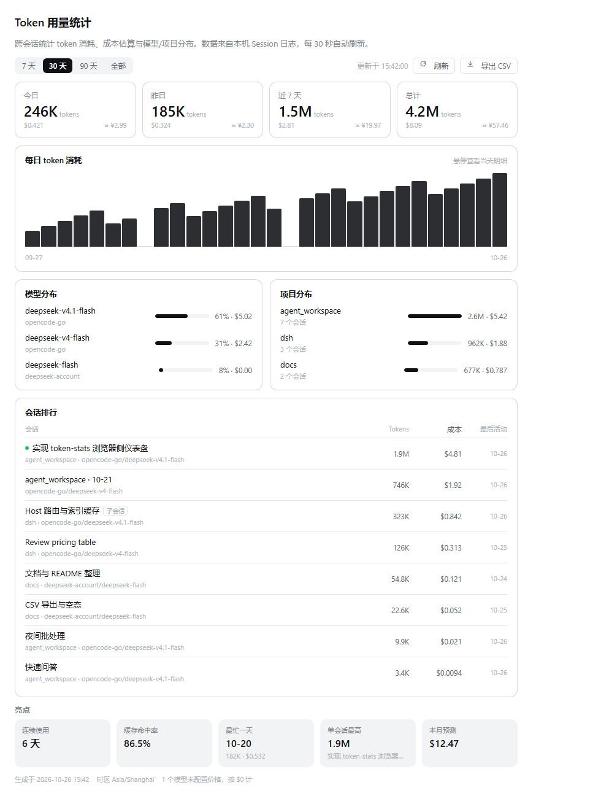

# dsh-plugin-token-stats

DeepSeek Harness（DSH）插件：**跨所有 session 的 token 用量统计 + 每日消耗 + 成本估算**。

宿主侧直接读取本地 session 日志（只读、不出本机），在 Web GUI 里提供设置页仪表盘和侧边栏快捷入口，
另外注册一个 `token_stats` 工具，随时可以问模型「这个月用了多少 token」。

## 特性

- **全量 session 聚合**：扫描 `~/.dsh/sessions` 下所有历史会话，按模型 / 项目 / 会话 / 天维度汇总。
- **每日消耗**：今日、昨日、近 7 天、近 30 天、近 90 天、全部历史；按天柱状图；连续使用天数。
- **成本估算**：可配置每 1M token 单价（输入/输出/缓存读/缓存写），USD 为主、CNY 折算；未定价模型单独列出。
- **缓存洞察**：cache read / write 占比与缓存命中率 —— 长会话里这项通常占 token 大头。
- **会话排行**：最贵的 session、最忙的一天、平均每请求 token、本月消耗预测。
- **零配置可用，按需覆盖**：默认价格表覆盖 opencode-go / 官方账号的常用模型，可在 profile 里改成自己的价格。
- **增量索引**：只读新增/变更的 session 日志，结果缓存在 `~/.dsh/plugin-data/dsh-plugin-token-stats/`，重启不重扫。
- **模型工具**：`token_stats`（宿主侧注册），支持按天数查询。
- **导出**：仪表盘里一键导出 CSV（每天/每模型/每会话）。

## 界面预览

浅色 / 深色主题（真实组件渲染，数据为示例）：

| 浅色 | 深色 |
|---|---|
|  |  |

## 安装

### 一键（推荐）

```powershell
powershell -ExecutionPolicy Bypass -File .\install.ps1
```

脚本会备份 profile 配置、写入 `link:` 依赖与 bundle 条目、用 DSH 自带的 Node + pnpm 安装依赖。
然后**完全退出 DSH（托盘也退出）再启动**（bundle 层只在启动时读取，刷新页面不够）。

### 手动

1. 编辑 `%USERPROFILE%\.dsh\profiles\desktop\package.json`：

   ```jsonc
   {
     "dependencies": {
       "dsh-plugin-token-stats": "link:D:/proj/agent_workspace/dsh-plugin-token-stats"
     },
     "dsh": { "profile": { "bundles": [ /* ... */, "dsh-plugin-token-stats" ] } }
   }
   ```

2. 在 profile 目录用 DSH 自带 pnpm 安装：

   ```powershell
   cd "$env:USERPROFILE\.dsh\profiles\desktop"
   $dsh = "D:\software\ai\dsh"
   & "$dsh\resources\runtime\primary-runtime\dependencies\node\bin\node.exe" `
     "$dsh\resources\runtime\primary-runtime\dependencies\pnpm\bin\pnpm.cjs" install
   ```

3. 重启 DSH。

### 卸载 / 回滚

删掉 profile `package.json` 里的两处条目（dependencies + bundles），再跑一次 `pnpm install`，重启即可。
安装脚本每次都会生成 `package.json.bak-<时间戳>`，直接换回也可以。插件自身不改任何 DSH 配置，
删除插件目录 + `~/.dsh/plugin-data/dsh-plugin-token-stats/` 即为完全清除。

## 使用

- **设置页**：设置 → 「Token 用量」。
- **侧边栏快捷入口**：左下角设置按钮旁的图表小按钮，点击弹出同一个仪表盘。
- **时间范围**：7 / 30 / 90 天 / 全部，右上角可手动刷新（页面打开时每 30 秒自动刷新，切到后台暂停）。
- **问模型**：对话里直接说「用 token_stats 看看这个月用量」，模型会调用工具返回汇总。

## 配置

默认值见 [`cordis.patch.yml`](cordis.patch.yml)。要覆盖，在 **profile 的** `cordis.patch.yml` 里按 id 覆盖：

```yaml
- id: token-stats
  name: 'dsh-plugin-token-stats'
  config:
    prices:
      opencode-go/deepseek-v4.1-flash:
        input: 0.15      # 每 1M input token 的美元价
        output: 0.6
        cacheRead: 0.015
        cacheWrite: 0.15
      some-model:        # 只写 model 也能命中（跨 provider 兜底）
        input: 1
        output: 2
    currency: USD
    usdToCny: 7.1
    refreshIntervalMs: 15000
```

| 字段 | 默认 | 说明 |
|---|---|---|
| `prices` | 见文件 | 每 1M token 的 USD 单价；键为 `provider/model` 或 `model` |
| `currency` | `USD` | 展示币种（内部统一按 USD 计算，再折算） |
| `usdToCny` | `7.1` | CNY 折算汇率 |
| `readConcurrency` | `3` | 建索引时并发读取的 session 数 |
| `refreshIntervalMs` | `15000` | 索引刷新的最小间隔 |
| `refreshOnStart` | `true` | 启动时后台建索引 |

改配置后需要重启 DSH（bundle 层只在启动时读取）。

## 数据来源与隐私

- 只读 `~/.dsh/sessions/**/session*.jsonl(.zstd)`，不写日志、不联网、不读对话正文以外的内容
  （只取 `assistant/message` 事件的 `usage` 与模型标识，以及 session 头部的 cwd/创建时间）。
- 索引缓存在 `~/.dsh/plugin-data/dsh-plugin-token-stats/usage-index.v1.json`，可随时删除（下次会重建）。
- 统计范围是本机全部 session，包括子 agent 会话（在会话排行里标注 `isSubagent`）。

## 已知限制

- `totalTokens` 以日志里 provider 回报的 `usage.totalTokens` 为准；缺失时按各分项相加兜底。
- 成本是**估算**：价格表要自己按实际账单维护，缓存读/写的计价方式各 provider 不同。
- 正在进行的会话在持久化前（turn 结束前）数字会有延迟；插件会在下一次刷新时补上。
- 只统计有 `assistant/message` 且带 usage 的请求；被取消且未上报 usage 的步骤无法计入。

## 开发

```powershell
# 全部单测（73 项；逐文件直跑，避免 test runner 额外 spawn 子进程）
Get-ChildItem .\test -Filter *.mjs | ForEach-Object { node $_.FullName }

# 只跑浏览器 bundle 自检
node .\test\client.test.mjs

# 额外：生成可截图的界面预览页（浅色/深色/英文/空/加载/错误）
node .\test\client.test.mjs --emit-preview .\.tmp\preview
```

结构：

```text
lib/index.js          宿主入口（name/apply）
lib/host/             session 扫描、用量提取、聚合、定价、路由、模型工具
lib/client.js         浏览器 bundle（手写 ModuleLoader factory，无构建步骤）
test/                 node:test 单测（不依赖真实 ~/.dsh）
```

## 验证记录

- **单测**：73 项全绿（宿主 54 + 浏览器 19），测试全部使用临时 fixture，不触碰真实 `~/.dsh`。
- **真实数据对账**：用独立脚本直接解 zstd 会话日志算「真值」与插件输出比对——82+ 个 session 的
  逐会话 totalTokens、7 个分项、4 个模型分桶**逐项相等（delta = 0）**。
- **真实宿主加载**：在隔离 `DSH_HOME` + 隔离 profile 的 DSH 实例里启动，确认
  客户端入口出现在 boot graph 并通过组合校验、`/plugins/dsh-plugin-token-stats/client.js` 返回 200，
  宿主侧 `/api/token-stats.summary` 返回 200 与契约一致的 JSON。

## License

MIT
